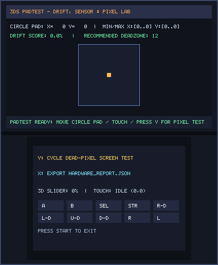
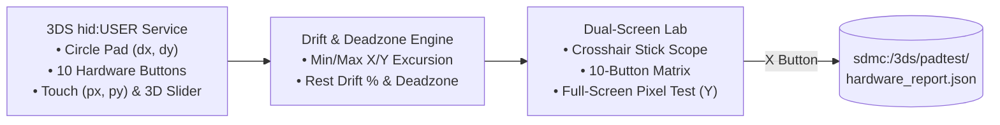

# PadTest (`3ds_padtest`)

<p align="center">
  
  &nbsp;&nbsp;&nbsp;
  
</p>

<p align="center">
  
</p>

> **Stick Drift & Screen Tester (`CTR-P-PADT`, UniqueId `0x0D3E7`)** — Part of the [**lafiabrew**](https://github.com/orgs/lafiabrew/repositories) Nintendo 3DS Homebrew Suite (companion hub: [`lafiabrew/3ds_hub`](https://github.com/lafiabrew/3ds_hub)).

Nintendo 3DS Circle Pad center-bias & drift % analyzer, min/max excursion tracker, 10-button test matrix, 3D slider & stylus touch verifier, dead-pixel screen cycler, and JSON report exporter.

---

## Architecture & Data Flow



---

## Controls & Touch Ergonomics (Old 3DS · 2DS · New 3DS XL)

| Button / Input | Action |
|---|---|
| Circle Pad | Rotate full circle to measure `Min/Max X/Y`, then release to measure resting **Drift %** and **Recommended Deadzone** |
| Hardware Buttons (`A/B/X/Y/L/R/SEL/D-Pad`) | Lights up the corresponding cell in the 10-button test matrix on the bottom screen |
| Stylus Touch | Draws a live tracking cursor on the bottom screen and displays exact `(X, Y)` pixel coordinates |
| `Y` (or Touch `Y: PIXEL TEST`) | Cycle full-screen Dead-Pixel / Backlight test patterns (`Red` → `Green` → `Blue` → `White` → `Black` → `Normal`) |
| `X` (or Touch `X: EXPORT JSON`) | Atomically export `sdmc:/3ds/padtest/hardware_report.json` |
| `START` | Exit to HOME Menu / Homebrew Launcher |

---

## SD Card Paths & Telemetry Logs

- `sdmc:/3ds/padtest/hardware_report.json` — Exported calibration, min/max excursion, drift %, and button mask report
- `sdmc:/3ds/logs/padtest.log` — Structured UTC operational log

---

## Build, Verify & Install

```bash
# 1. Run host C11 ASan/UBSan pass-the-pass & fail-the-fail unit + UI tests
make test

# 2. Build optimized ARM11 (-Os -flto + stripped ELF) .elf, .smdh, .3dsx, and .cia
make 3ds && make verify-3ds

# 3. Serve FBI QR code or push .cia over LAN via serve_3ds.py
make qr
```
